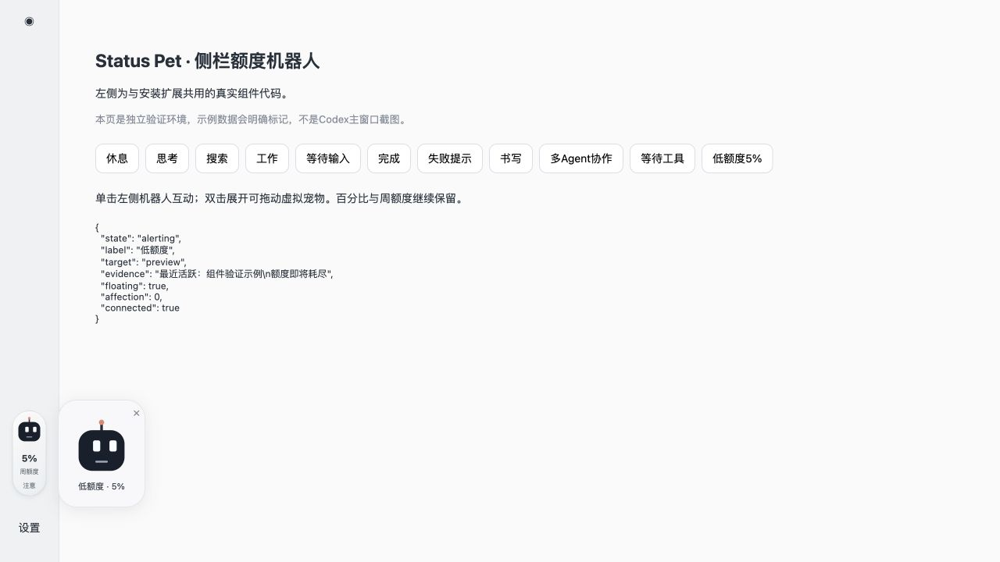

# Codex Status Pet

A local-first status companion for Codex Desktop on macOS. Keep quota percentages in the existing sidebar badge, animate a small original robot with task events, and open a draggable companion window inside the client.

**中文说明**：为 Codex 桌面端增加工作状态机器人、额度显示、窗口内可拖动宠物，以及后台守护与兼容升级保护。它是基于 [Codex Usage Badge](https://github.com/jaykinhoo9/codex-usage-badge) 的非官方本地扩展，不是 OpenAI 官方插件接口。



## What is included

- Sidebar percentage and quota-window labels are preserved.
- Local events map to thinking, searching, tool execution, writing, waiting, collaboration, completion, interruption, and explicit errors.
- Single-click interaction; double-click to show/hide a draggable in-window pet. Enter interacts; Space toggles the pet.
- A launch agent keeps the monitor running after login. A guardian checks the services every 15 seconds.
- Optional stable upstream badge updates: hourly checks, archive verification, patch preflight, and backups. Incompatible layouts are rejected before modifying the installed agent.
- Honest health reporting: a running process is not proof of a visible sidebar. Missing attachment transport is reported as requiring user action.

This repository ships an **original rounded-square robot renderer under MIT**. It does not contain the Grok engine, extracted geometry, xAI artwork, GIFs, sprite sheets, ChatGPT Pets assets, local conversations, or credentials. The private Grok study used during development is not redistributed. See [THIRD_PARTY_NOTICES.md](THIRD_PARTY_NOTICES.md).

## Requirements

- macOS, Node.js 24+, Python 3.9+.
- An existing, working Codex Desktop installation and login.
- [Codex Usage Badge](https://github.com/jaykinhoo9/codex-usage-badge) installed first. The current patch baseline is macOS v0.9.4.
- Its local attachment transport must be available on `127.0.0.1:39222`.

The client DOM and local event database are implementation details and may change. Windows and Linux installation are not supported by this release. Cloud-only or remote chat events are not guaranteed to be available locally.

## Preview without modifying Codex

```sh
git clone https://github.com/0525ma/codex-status-pet.git
cd codex-status-pet
npm test
npm run check
npm run preview
```

Open `http://127.0.0.1:8792`. The preview uses explicitly labeled simulated data and the same injected component code. It does not connect to a Codex window.

## Install

Review the code and install upstream Codex Usage Badge first. Then:

```sh
python3 scripts/install.py --dry-run
python3 scripts/install.py
```

To opt in to compatible upstream **badge** upgrades:

```sh
python3 scripts/install.py --auto-update
```

Use one install command, not both. This does not upgrade Codex Desktop itself or automatically download new versions of this repository. It does not create a ChatGPT scheduled automation. If an existing private Grok customization is detected, installation stops rather than overwriting it.

Files are installed under `~/Library/Application Support/CodexStatusPetGuardian`; the existing badge's `agent.cjs`, update worker, update settings, and launch configuration are backed up before changes. See [architecture and boundaries](docs/ARCHITECTURE.md).

### If the sidebar is missing

A background process can be running while the current client was started without its attachment transport. Quit Codex yourself with **Cmd+Q**, then run:

```sh
python3 scripts/launch_codex.py
```

The launcher refuses to close an already-running client. It requests a normal launch with the upstream extension's loopback-only connection parameters. Wait for the background addon to attach; a successful launch request is not visual verification.

### Status and uninstall

```sh
cat "$HOME/Library/Application Support/CodexStatusPetGuardian/status.json"
python3 scripts/uninstall.py
```

Uninstall restores the saved upstream badge files and launch configurations. Backups and local assets are retained. Reopen Codex manually if old injected UI is still visible in an existing window.

## State evidence

| State | Source |
|---|---|
| Thinking | Reasoning item or tool return |
| Searching | Search tool call |
| Working | Command execution or a general tool call |
| Writing | File-edit tool call |
| Waiting | Waiting tool or explicit input request |
| Collaboration | Agent coordination tool call |
| Completed | Explicit completed-turn event or final reply |
| Interrupted | Explicit abort event |
| Error | Explicit error event or structured tool failure |
| Unknown | Stale/missing events; never assumed to be success or zero quota |

The reader examines at most 24 recently updated unarchived local tasks. Event mapping is not equivalent to direct telemetry from every Codex subsystem. If the active chat cannot be resolved, the companion labels its source as the most recently active task. A long quiet period is reported as unknown, not failure.

## Custom renderers

`runtime/pet-renderer.js` supplies `window.StatusPet`. A renderer implements `setState`, `setPaused`, `bounceOnce`, and `destroy`; see the source for pointer tracking and lifecycle. You may replace it locally with artwork and code you have permission to use. Keep restricted assets in an ignored local directory; do not assume an attribution notice grants redistribution rights.

## Verification

The release includes event, connection-health, patch preflight, idempotence, and incompatible-layout tests. CI also scans tracked files for common secret patterns and machine-specific paths. The browser preview can be verified independently of the desktop client.

Native attachment was exercised in the local development setup, but this public distribution has **not** been installed across a clean macOS machine or every Codex release. No new upstream version was available during the initial guardian checks, so a complete real-version upgrade is not claimed as tested.

## License

MIT for original project code and the credited upstream MIT fixture. No OpenAI or xAI affiliation or endorsement is implied. Restricted Grok study materials are intentionally excluded.
